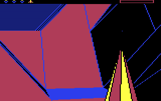

***Claude - including Fable - was unable to solve this simple game from 1986 without my help. Is what it is.***


# The Sentinel — ROM-faithful model + live driver

A ROM-faithful model of **The Sentinel** (Geoff Crammond, Firebird, 1986) on the
Commodore 64, plus a live driver that plays the real game in
[VICE](https://vice-emu.sourceforge.io/) (asid-vice) by keyboard and records an AVI.
Transition primitives are validated byte-for-byte against the real 6502 code (golden
fixtures, so CI proves them without the ROM); the enemy clock is gated frame-for-frame
against the running game by the divergence instrument.

The phase player wins **live, on the real game**, verified by the ROM's own
landscape-complete flag (`$0CDE` bit 6) — including landscape 1442, which carries the
game's full complement of **eight enemies** (the Sentinel and seven sentries), as the results table records:



```bash
pip install -r requirements.txt
pytest -n auto
# optional CUDA backend (SENTINEL_BACKEND=cpu|cuda|auto): see docs/architecture.md (also: batched multi-state queries, `sentinel/batch.py`)
pip install -r <(grep -v '^numpy' requirements.txt) -r requirements-gpu.txt

python -m sentinel.phase_player 335     # offline, prints the action trace
python -m driver.play_player 335        # live in VICE, records an AVI
python -m driver.instrument 42          # race the model against the ROM, frame for frame
python -m driver.avi2apng renders/player_ls335_win.avi   # the AVI as an embeddable APNG
```

<!-- results:begin -->
| landscape | enemies | offline actions | offline energy | beam actions | beam energy | live |
|---|---|---|---|---|---|---|
| 0 | 1 | 29 | 9 | 11 | 2 | — |
| 42 | 2 | 32 | 2 | 19 | 2 | **36 actions** (enemies frozen)† |
| 60 | 7 | 43 | 0 | 21 | 3 | — |
| 110 | 3 | 51 | 11 | 19 | 0 | — |
| 298 | 7 | 36 | 13 | 18 | 7 | — |
| 321 | 7 | 28 | 2 | 18 | 1 | — |
| 335 | 7 | 60 | 23 | 34 | 2 | [**66 actions**, energy 25](docs/media/ls335_phase_win.png)† |
| 373 | 7 | 32 | 2 | 12 (not won) | 1 | — |
| 1442 | 8 | 45 | 18 | 19 | 2 | [**29 actions**, energy 5](docs/media/ls1442_phase_win.png)† |

† Live run recorded against an older model: its trace digest is unrecorded or differs from the current offline trace for that board.

Regenerate with `python -m sentinel.tests.trace_suite --out docs/results/offline.json --readme` and `python -m sentinel.tests.trace_suite --player beam --out docs/results/beam.json --readme`.
<!-- results:end -->

Results are generated from [docs/results/](docs/results/) (offline records with a trace
digest, live runs with their media); the staleness tests fail when the table or the data
drifts from the solver. Enemy counts include the Sentinel, so eight is the game's maximum.
Settle prices, the frozen-run mode and the ls1442 media are described in
[players.md](docs/players.md#results) and [media.md](docs/media.md).

A landscape is identified by one number: the one a player types on the keypad. Every tool
here — `driver.play_player`, `sentinel.phase_player`, `sentinel.player`, `sentinel.isoview`
— takes exactly that number, and `Game.typed(335)` builds the same board offline.

## Layout

| Area | Path | Role |
|------|------|------|
| Model | `sentinel/` | standalone forward model — terrain, LOS/aim, actions, energy, enemies, landscape generation (no emulator). Transition primitives are byte-for-byte against the 6502; see [architecture.md](docs/architecture.md) for what is exact and what is not |
| Phase player | `sentinel/phase_player.py` | the default player: freedom first, then convert. Wins every suite board |
| Reactive player | `sentinel/player.py` | tick-by-tick greedy player over the same `BasePlayer` |
| Landscape atlas | `sentinel/atlas.py`, `sentinel/statecache.py` | per-landscape metrics (enemies, energy, terrain shape) over a cache of generated boards; `--like` matches one board to another |
| Driver | `driver/` | boot, enter a landscape, run memory-verified live keyboard operations (aim → fire → verify), record. Imports only `sentinel/` |
| Instrument | `driver/instrument.py`, `sentinel/statecmp.py` | frame-locked sim-vs-emulator divergence: seed the sim from the live image, step both one frame at a time, report the first disagreement |

## Fixtures (not distributed)

The game is copyrighted and is **not** included.

`out/sentinel_stage2.bin`, the 64 KB memory image of the loaded game that the `oracle`-marked
tests run, is built from the [CSDb release](https://csdb.dk/release/?id=233853): the D64 is
downloaded once into `out/csdb/` (SHA-256 pinned) and booted headless in jennings, running the
game's own setup and title screen under a PAL raster interrupt to its keyboard wait. `pytest`
builds it automatically when absent; set `SENTINEL_REQUIRE_ORACLE=1` to fail rather than skip
without it (CI does).

```bash
python -m sentinel.tests.csdb                   # --out PATH, --force to rebuild
```

The live driver plays your own copy of the tape image at `sentinel-gold.tap`, and needs Docker
and the `anarkiwi/asid-vice:latest` image (build from https://github.com/anarkiwi/asid-vice).
`python -m driver.dump_stage2` dumps the oracle image from that tape instead.

## Docs

- [gameplay.md](docs/gameplay.md) — the game's rules and mechanics, ROM-derived spec.
- [architecture.md](docs/architecture.md) — the landscape's geometry and the constraints it
  imposes, the game's state machines, one table mapping every ROM routine to its model
  function and validation, then the subsystems: landability filter, render-cost model,
  driver, instrument, measurement tooling.
- [players.md](docs/players.md) — the phase player and the reactive greedy player: the rules
  that decide a move, the phases, current results.
- [media.md](docs/media.md) — turning a recorded run into an embeddable APNG, and the
  blank test that drops the hyperspace and transfer frames.
- [open_items.md](docs/open_items.md) — everything unsolved, and what was disproved.
