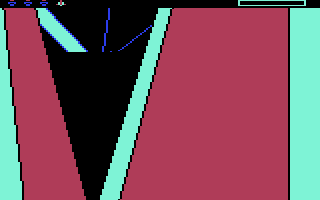

***Claude - including Fable - was unable to solve this simple game from 1986 without my help. Is what it is.***


# The Sentinel — ROM-faithful model + search player

A ROM-faithful model of **The Sentinel** (Geoff Crammond, Firebird, 1986) on the
Commodore 64, and a search player that plays the real game. Game time is the real ROM
running on [vagrant-moses](https://github.com/anarkiwi/vagrant-moses), a cycle-exact
emulated C64: the search plans on forks of the emulated game and plays its line either
open loop there or move by move in [VICE](https://vice-emu.sourceforge.io/) (asid-vice),
by keyboard, recording an AVI and auditing every move against the emulated session.
Static primitives (landscape generation, line of sight, the sights lattice, object sight)
are validated byte-for-byte against the real 6502 code.



```bash
pip install -r requirements.txt
pytest -n auto
# optional CUDA backend for the landing and pricing kernels (SENTINEL_BACKEND=cpu|cuda|auto)
pip install -r <(grep -v '^numpy' requirements.txt) -r requirements-gpu.txt

python -m driver.play_player 335 --emu     # search player on the emulated release, open loop
python -m driver.play_player 335           # the same search, each move also played live in VICE (AVI)
python -m driver.emu_suite                 # every suite board on the emulator, in parallel
python -m driver.decision_audit 335        # every candidate at each decision, forced and played out
python -m driver.avi2apng renders/player_ls335_search.avi   # the AVI as an embeddable APNG
```

<!-- results:begin -->
| landscape | enemies | search actions | search energy | live |
|---|---|---|---|---|
| 0 | 1 | 11 | 0 | — |
| 42 | 2 | 16 | 1 | [**16 actions**, energy 1](docs/media/ls42_search_win.png) |
| 60 | 7 | 20 | 3 | — |
| 110 | 3 | 17 | 2 | — |
| 298 | 7 | 18 | 6 | — |
| 321 | 7 | 17 | 2 | — |
| 335 | 7 | 26 | 1 | [**26 actions**, energy 1](docs/media/ls335_search_win.png) |
| 373 | 7 | 17 | 0 | — |
| 1442 | 8 | 18 | 5 | [**18 actions**, energy 5](docs/media/ls1442_search_win.png) |
| 9716 | 8 | 26 | 2 | [**26 actions**, energy 5](docs/media/ls9716_search_win.png) |
| 9795 | 8 | 51 | 2 | [**48 actions**, energy 2](docs/media/ls9795_search_win.png) |
| 9950 | 8 | 25 | 3 | [**25 actions**, energy 6](docs/media/ls9950_search_win.png) |

Regenerate with `python -m driver.emu_suite --out docs/results/search.json --readme`.
<!-- results:end -->

Results are generated from [docs/results/](docs/results/) (`search.json`: the search
player's emulated runs with a trace digest; `live.json`: live runs with their media); the
staleness test fails when the table drifts from the data. Enemy counts include the
Sentinel, so eight is the game's maximum. See [players.md](docs/players.md) and
[media.md](docs/media.md).

A landscape is identified by one number: the one a player types on the keypad. Every tool
here — `driver.play_player`, `driver.emu_suite`, `driver.decision_audit`,
`sentinel.isoview` — takes exactly that number, and `Game.typed(335)` builds the same board
offline.

## Layout

| Area | Path | Role |
|------|------|------|
| Model | `sentinel/` | landscape generation, terrain, line of sight, the sights lattice and landing sweeps, object sight, board queries; byte-for-byte against the 6502 (see [architecture.md](docs/architecture.md)) |
| Moves | `sentinel/moves.py`, `sentinel/views.py` | candidate moves of many boards over numpy arrays, each aimed by its tile's frame-cheapest keyboard view |
| Emulated game | `sentinel/emu.py`, `driver/emu.py` | the CSDb release on vagrant-moses, entered as a player types it, behind the same monitor API as VICE |
| Search player | `driver/search_player.py`, `driver/prog.py`, `driver/kbd_prog.py` | beam search whose children are compiled keyboard programs run on emulator forks |
| Driver | `driver/` | boot VICE, enter a landscape, play and record; imports only `sentinel/` |
| Landscape atlas | `sentinel/atlas.py`, `sentinel/statecache.py` | per-landscape metrics over a cache of generated boards |

## Fixtures (not distributed)

The game is copyrighted and is **not** included.

`out/sentinel_stage2.bin`, the memory image of the loaded game that the `oracle`-marked tests
run, is built from the [CSDb release](https://csdb.dk/release/?id=233853): the D64 is downloaded
once into `out/csdb/` (SHA-256 pinned) and RUN on vagrant-moses (real ROMs fetched and
verified) to the title's keyboard wait. `pytest` builds it automatically when absent; set
`SENTINEL_REQUIRE_ORACLE=1` to fail rather than skip without it (CI does).

```bash
python -m sentinel.tests.csdb                   # --out PATH, --force to rebuild
```

The live driver plays your own copy of the tape image at `sentinel-gold.tap`, and needs Docker
and the `anarkiwi/asid-vice:latest` image (build from https://github.com/anarkiwi/asid-vice).
`python -m driver.dump_stage2` dumps the oracle image from that tape instead.

## Docs

- [gameplay.md](docs/gameplay.md) — the game's rules and mechanics, ROM-derived spec.
- [architecture.md](docs/architecture.md) — the landscape's geometry, the game's state
  machines, the ROM routines and their model functions, the emulated game, driver programs,
  view selection, landing sweeps and kernels.
- [players.md](docs/players.md) — the search player: moves, objective, presets, live audit,
  decision audit.
- [media.md](docs/media.md) — turning a recorded run into an embeddable APNG.
- [open_items.md](docs/open_items.md) — what is unsolved, and what was disproved.
